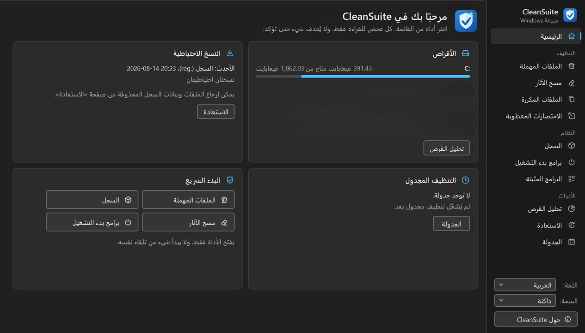
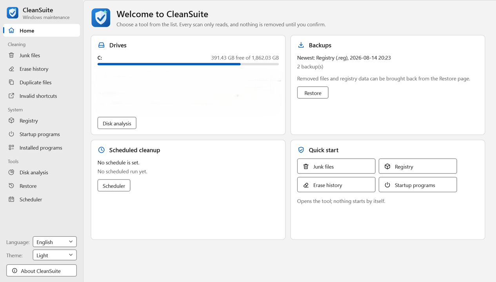

# CleanSuite

**A free, open-source maintenance tool for Windows 10 and 11, in Arabic and English.**

CleanSuite finds junk files, traces of use, duplicate files, broken shortcuts and invalid registry entries, manages startup
and installed programs, and shows what fills your disks. Every scan only reads; nothing is removed until you review the
results and confirm, and every change can be undone from the Restore page.

[العربية](#بالعربية) · [Download](https://github.com/abosalehg-ui/CleanSuite/releases) · [License: MIT](LICENSE)

| Arabic, dark theme | English, light theme |
|---|---|
|  |  |

## Features

| Tool | What it does |
|---|---|
| **Junk files** | Temporary files, crash dumps, leftover installer and backup files on chosen drives or folders, with ignore lists |
| **Erase history** | Recent-file lists, Run history, clipboard, Windows logs and the Firefox family's history, keeping the cookies you choose |
| **Duplicate files** | Same name, size or date, confirmed by comparing content (MD5 or CRC-32); always keeps at least one copy |
| **Invalid shortcuts** | Shortcuts whose program is gone; delete them or point them at the new location |
| **Registry** | 16 categories of entries that point to missing files, with built-in protection for the parts Windows and installers manage |
| **Startup programs** | Run keys and startup folders: disable, enable or delete, and spot entries that turned themselves back on |
| **Installed programs** | Uninstall, change or repair, find entries whose uninstaller is missing, export the list |
| **Disk analysis** | "This PC" with every drive's capacity; choose a drive and it is analyzed at once: folder tree by size, pie charts of the largest folders and files and of the file types, folder contents, the 100 largest files, empty folders |
| **Restore** | Every backup CleanSuite made (files and registry), restored in a few clicks |
| **Scheduler** | Runs the cleaners automatically through Windows Task Scheduler |
| **Registry compactor** | Measures how much the registry hives would shrink (analysis only) |

## Safe by design

- Scans never change anything. Results are shown for review first.
- Files go to the Recycle Bin or into a zip backup; drives without a Recycle Bin are refused instead of deleting for good.
- Every registry key or value is exported to a `.reg` file before it is changed. A `.reg` file CleanSuite did not write never
  restores the keys that start programs.
- Files or keys that changed since the scan are skipped. Windows folders and protected locations are never touched, also when
  a folder was replaced by a link to them after the scan.
- Every operation is written to a journal in `%LocalAppData%\CleanSuite\Journal`.
- CleanSuite runs with normal user rights. Some system-wide items need "Run as administrator", and the program says so.

## Install

Download `CleanSuite-Setup-<version>.exe` from [Releases](https://github.com/abosalehg-ui/CleanSuite/releases) and run it.
It needs 64-bit Windows 10 version 1809 or later; .NET does not have to be installed. The setup installs for your user
without administrator rights (or for all users if you choose), and uninstalling keeps your backups unless you ask to
delete them.

Releases up to 1.1.0 are not signed. SmartScreen may show "Windows protected your PC" (choose **More info** → **Run
anyway**), and on a computer with **Smart App Control** turned on Windows refuses to run the program ("An Application
Control policy has blocked this file", error 4551). Signed releases are on the way; see the
[code signing policy](#code-signing-policy).

## Use

Choose a tool in the side bar, press **Scan** (or F5), review the list, untick what you want to keep, then press the
clean button. Language and theme are at the bottom of the side bar.

Keyboard: F5 scans or refreshes the current page, Esc cancels, Space ticks or clears the selected row, Ctrl+A checks every
row of a result list and Delete cleans the checked rows (after asking). In Disk analysis, Alt+← / Alt+→ / Alt+↑ go back,
forward and up. Screen readers (Narrator, NVDA) and Windows contrast themes are supported. In a narrow window the side bar
folds to icons; the menu button unfolds it.

## Build from source

Requires the [.NET 10 SDK](https://dotnet.microsoft.com/download) on Windows.

```
dotnet test CleanSuite.sln
dotnet run --project src/CleanSuite.App
```

The installer needs [Inno Setup 6.4+](https://jrsoftware.org/isinfo.php). One command runs the tests, publishes the
program and builds `artifacts/installer/CleanSuite-Setup-<version>.exe`:

```
powershell -ExecutionPolicy Bypass -File .\build.ps1 [-SkipTests] [-Version 1.0.1]
```

`CleanSuite.Cli.exe` is a read-only command-line companion (`registry scan`, `junk scan`, `duplicates scan`,
`shortcuts scan`, `uninstall list`…); `CleanSuite.Cli --help` lists every command and option.

Command-line options, project layout and the CLI reference are in [`docs/DEVELOPMENT.md`](docs/DEVELOPMENT.md); design
notes and the remaining work in [`NEXT_STEPS.md`](NEXT_STEPS.md) (Arabic).

## Background

CleanSuite is an independent program, written from scratch, that provides the tools of the discontinued
Ace Utilities. It can read that program's settings, ignore lists and backups (read only) and restore its backups.
It contains no code, images or other material of Ace Utilities and is not affiliated with Acelogix.

## Code signing policy

Free code signing provided by [SignPath.io](https://about.signpath.io), certificate by
[SignPath Foundation](https://signpath.org) (applied for; releases are signed once the application is approved).

- Only files built from this repository by its GitHub Actions workflow ([`build.yml`](.github/workflows/build.yml)) from a
  version tag are signed: `CleanSuite.App.exe`, `CleanSuite.Cli.exe`, the uninstaller and `CleanSuite-Setup-<version>.exe`.
- Every signing request is approved by hand before the files are signed.
- Committers and reviewers: [abosalehg-ui](https://github.com/abosalehg-ui) · Approvers:
  [abosalehg-ui](https://github.com/abosalehg-ui) (owner)

**Privacy:** this program will not transfer any information to other networked systems unless specifically requested by
the user or the person installing or operating it. CleanSuite makes no network connections; it opens its GitHub page only
when you click the link in the About window.

How signing is set up: [`docs/CODE_SIGNING.md`](docs/CODE_SIGNING.md) (Arabic).

## License

[MIT](LICENSE) © 2026 abosalehg-ui

---

## بالعربية

**CleanSuite أداة مجانية ومفتوحة المصدر لصيانة Windows 10 و11، بالعربية والإنجليزية.**

يبحث عن الملفات المهملة، وآثار الاستخدام، والملفات المكررة، والاختصارات المعطوبة، وعناصر السجل غير الصالحة، ويدير برامج
بدء التشغيل والبرامج المثبتة، ويعرض ما يشغل مساحة الأقراص برسوم بيانية. كل فحص للقراءة فقط، ولا يُحذف شيء قبل أن تراجع
النتائج وتؤكد، وكل تغيير يمكن التراجع عنه من صفحة «الاستعادة».

- **التثبيت:** نزّل `CleanSuite-Setup-<الإصدار>.exe` من [الإصدارات](https://github.com/abosalehg-ui/CleanSuite/releases)
  وشغّله. يحتاج Windows 10 (الإصدار 1809) أو أحدث، 64 بت، ولا يحتاج تثبيت .NET. الإصدارات حتى 1.1.0 غير موقّعة، فقد يظهر
  تحذير SmartScreen (اختر «مزيد من المعلومات» ثم «التشغيل على أي حال»)، وفي جهاز مفعَّل فيه **التحكم الذكي في التطبيقات**
  (Smart App Control) يمنع Windows تشغيل البرنامج (الخطأ 4551). الإصدارات الموقّعة قادمة.
- **سياسة التوقيع:** توقيع مجاني من [SignPath.io](https://about.signpath.io) بشهادة من
  [SignPath Foundation](https://signpath.org) (الطلب مقدَّم). لا يُوقَّع إلا ما يبنيه GitHub Actions من هذا المستودع لوسم إصدار،
  وبعد موافقة يدوية على كل طلب. المطوّر والمراجع والموافِق: [abosalehg-ui](https://github.com/abosalehg-ui). **الخصوصية:**
  البرنامج لا يرسل أي معلومات عبر الشبكة إلا إذا طلب ذلك المستخدم صراحة، ولا يتصل بالإنترنت أصلًا.
- **الاستخدام:** اختر أداة من الشريط الجانبي، واضغط «فحص» (أو F5)، وراجع القائمة، وأزل التحديد عما تريد إبقاءه، ثم نظّف.
  في «تحليل القرص» اختر قرصًا من شجرة «هذا الكمبيوتر» فيُحلَّل فورًا، وتظهر أكبر المجلدات والملفات وأنواع الملفات برسوم دائرية.
- **الأمان:** الملفات تُنقل إلى سلة المحذوفات أو نسخة zip، وكل تعديل في السجل تسبقه نسخة `.reg`، وما تغيّر بعد الفحص
  يُتخطّى، ومجلدات النظام لا تُمس، وكل عملية تُسجَّل.
- **الرخصة:** [MIT](LICENSE).
